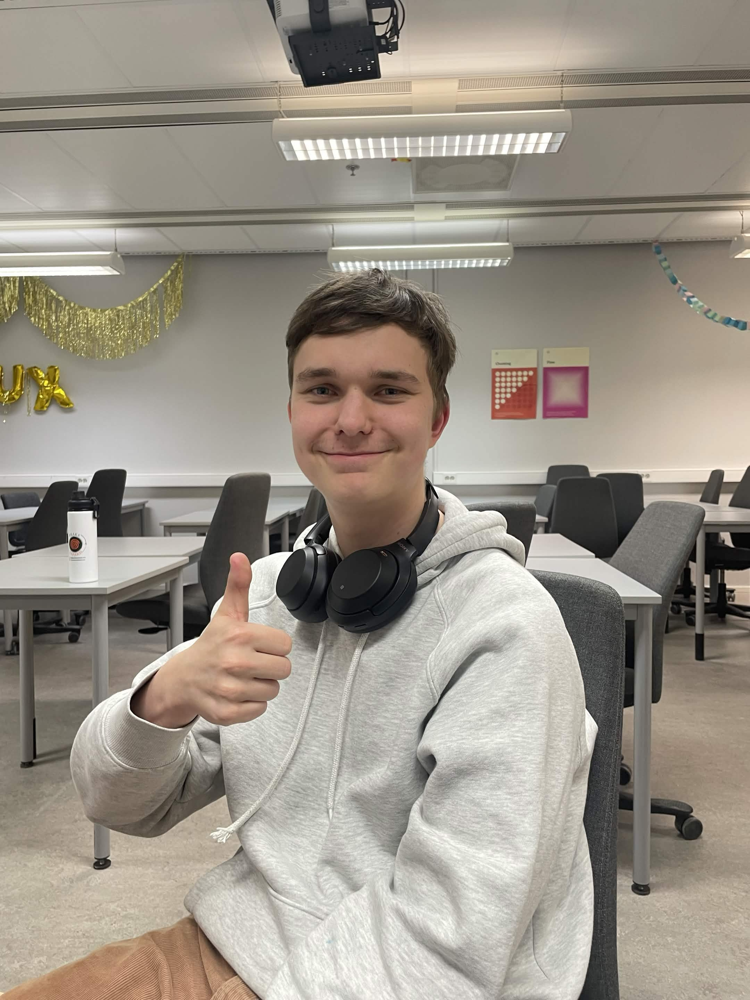
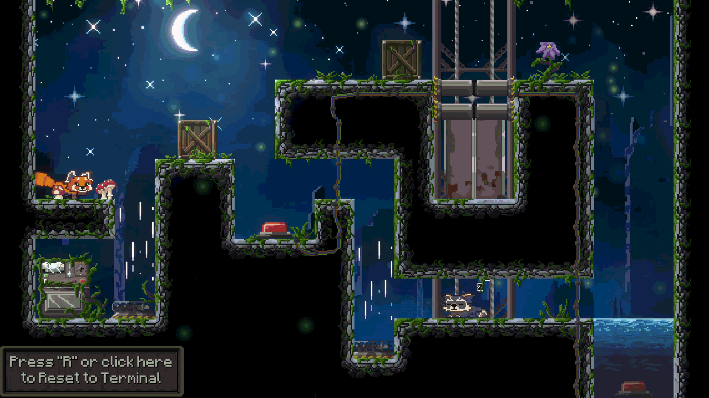
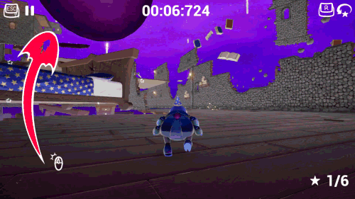
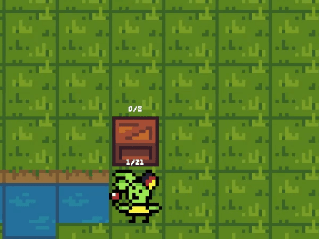
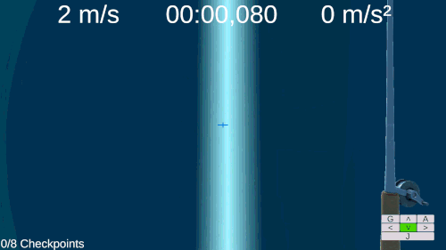

# Ivar Holmudd Portfolio 

# CV
My entry into game development started with mods for Rivals of Aether during the 2020 covid lockdown, getting to work with established architecture and a game with a strong community kickstarted my interest in game development. Since then I've graduated from LBS, started studying programming at Yrgo and continued to make the types of games I really enjoy.

Here below are a few of the projects I've worked on
# Games 

## [**Shifting Order**](https://yrgo.itch.io/shifting-order) ← Click here for more info!
**Role** Project lead, Game designer, Level designer

**Engine:** Unity (C#)

**Project Length:** 8 Weeks from November 2025 - Januari 2026

**Team size:** 4 Programmers 3 Artist

*You change the gravity, temperature, time and wind of the level to find a possible solution*

 

---

## [**Go! My Scarab**](https://yrgo.itch.io/go-my-scarab) ← Click here for more info!
**Role** Program lead, Game designer, Level designer

**Engine:** Unreal Engine 5 (Blueprint)

**Project Length:** 8 Weeks from April 2026 - June 2026

**Team size:** 3 Programmers 4 Artist

*A 3d platformer where you play as a very mobile scarab trying to push your very big orb through a level to collect checkpoints in your own order*

 

---

## [**Postponed Propulsion**](https://dumlo.itch.io/postponed-propulsion) ← Click here for more info!
**Role** Level Design, Director, Game designer

**Engine:** Built Own with SDL3 (C++)

**Project Length:** 8 Weeks from April 2026 - June 2026

**Team size:** 3 Programmers

*Sokoban Puzzle game where you store momentum within pushable boxes to find the correct combination of inputs*

 

---

## [**Guard of the Crossing**](https://dumlo.itch.io/guard-of-the-crossing) ← Click here for more info!
**Role** Game Designer, Programmer

**Engine:** Unity (C#)

**Project Length:** 3 Weeks during October 2026

**Team size:** 4 Programmers 3 Artists

*A vr game where you slice, parry and dodge your way through a barrage of projectiles*

---

## [**Yank The Plank**](https://dumlo.itch.io/yank-the-plank) ← Click here for more info!
**Role** Program lead, Game Designer, Level designer, Generalist

**Engine:** Unity (C#)

**Project Length:** 6 Months from September 2024 - February 2025

**Team size:** 2 Programmers

*Yank The Plank is a speedrunning game where your velocity grows exponentially during each level*

 

# Contact Me
[**Linkedin**](https://www.linkedin.com/in/ivar-holmudd-41aa3b415)

[**Gmail**] ivar.holmudd@gmail.com 

[**Itch**](https://dumlo.itch.io)
